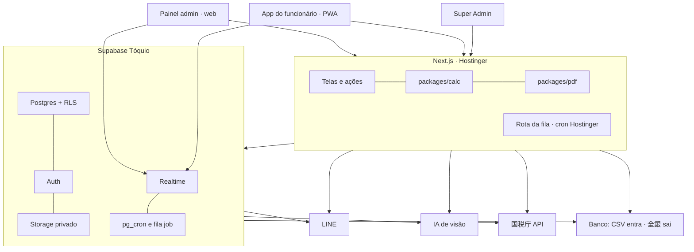

# Documento-âncora — NEO-SYSTEM

17/10/2026 · Mike Inoue · produto renomeado de "SaaS Genba" para **NEO-SYSTEM** em 28/10/2026

Este é o documento de referência do projeto: toda decisão de produto, arquitetura e desenvolvimento parte daqui. Ele consolida o debate registrado na [Especificação — SaaS Genba (refatoração)](https://claude.ai/code/artifact/d80679a4-73d7-4b55-bb3f-d8e61b066e14), corrige as inconsistências encontradas nela e define o roadmap, a arquitetura e as diretrizes de cada camada. Os mockups estão em [SaaS Genba — Mockups](https://claude.ai/artifact/E2etPQxYUqcZkrvK666n8K).

**Como usar:** em conflito entre este documento e a especificação, vale este. Quando o repositório no GitHub for criado, este conteúdo vira `docs/00-ancora.md` e o repositório passa a ser a fonte oficial; cada camada ganha seu documento próprio (seção Documentação e governança). Mudanças em decisões daqui entram por registro de decisão (ADR), nunca por edição silenciosa.

**Versão:** 1.0 · 17/10/2026 · responsável: Mike.

## Visão do produto e princípios

SaaS multi-empresa para empresas de genba (manutenção e construção terceirizada) com equipes majoritariamente estrangeiras no Japão. Substitui o MVP em Bubble usado pela Sugita Kogyo (株式会社杉田工業), primeira cliente, e será oferecido a outras empresas que já pediram acesso.

**Problema que resolve:** hoje a escala sai como texto no LINE, os dias são lançados à mão, e 勤怠表, 請求書 e holerites são montados separadamente. O sistema faz de um único registro (a escalação) a origem de tudo: confirmação diária, 勤怠表, fatura ao cliente, folha e caixa.

**Dois públicos:**

- **Escritório (admin web):** escala, fecha, fatura, paga e acompanha o caixa.
- **Campo (app do funcionário, PWA):** vê a escala, confirma o dia, consulta pagamentos e documentos, no próprio idioma.

**Princípios de projeto (valem para todas as camadas):**

1. **Um fato, um registro.** Holerite, fatura e caixa são derivados; nada é digitado duas vezes.
2. **O passado não muda sozinho.** Configurações têm vigência, fechamentos guardam snapshot, períodos fechados travam, correções geram nova versão.
3. **Nada é apagado de verdade.** Exclusão lógica, lixeira, log de auditoria; documentos emitidos são imutáveis.
4. **A lei vence a configuração.** Mínimos legais são travas do sistema; a empresa não configura abaixo deles.
5. **Isolamento no banco.** A separação entre empresas e os limites de plano são garantidos no servidor e no banco, não na tela.
6. **Campo primeiro.** O app do funcionário funciona com um toque, em vários idiomas, com sinal ruim.
7. **Validar antes de confiar.** Todo cálculo de dinheiro tem testes com casos reais e roda em paralelo com o sistema antigo antes de substituí-lo.

## Modelo de negócio e propriedade

O código e o SaaS são do Mike; a Sugita financia o desenvolvimento e recebe código-fonte, uso garantido para sempre e participação no SaaS. Hoje isso é um acordo verbal entre o Mike e o 社長 e precisa virar documento escrito antes do M0.

**Situação:** Mike é 社員 da Sugita (trabalha em genba) e é o desenvolvedor do sistema atual no Bubble e do novo sistema.

**Risco:** pelo 著作権法 art. 15 (職務著作), um programa feito por funcionário por iniciativa da empresa, sem contrato que diga o contrário, pode ter a empresa como autora. Um acordo verbal não protege nenhum dos dois em mudança de gestão, venda da empresa ou desentendimento.

**Decisão:** um contrato ou 覚書 entre o Mike e a Sugita, revisado por 弁護士, assinado antes do M0 (bloqueante). Conteúdo mínimo:

| Cláusula | Conteúdo |
| --- | --- |
| Natureza do trabalho | O desenvolvimento do sistema é trabalho independente, separado das funções de 社員 (genba) |
| Propriedade | Direitos autorais do código (novo sistema e app atual no Bubble) são do Mike; a Sugita não reivindica 職務著作 |
| Licença da Sugita | Permanente, irrevogável e gratuita para uso interno, com direito de modificar; sem revenda ou distribuição |
| Código-fonte | Acesso de leitura ao repositório (ou cópia a cada versão) |
| Continuidade | Se o SaaS parar ou o Mike não puder manter, a Sugita instala por conta própria e contrata outro desenvolvedor para a instância dela |
| Dados | Sempre da Sugita, com exportação completa a qualquer momento |
| Participação | % da receita bruta do SaaS (ou ações de futura empresa do SaaS, com cláusula de conversão); percentual e prazo a definir |
| Atividade paralela | Autorização expressa para o Mike operar o SaaS e vendê-lo a outras empresas de genba (cobre 副業 e 競業 do 就業規則) |
| Sigilo nos dois sentidos | Dados e informações da Sugita nunca vão para outros clientes; a Sugita, como sócia, não tem acesso operacional a dados de outros clientes |
| Custos | Quem paga hospedagem, plataforma e manutenção após o go-live |
| Aprovação | Assinado pelo 社長 como representante da empresa, com aprovação do órgão societário se o estatuto exigir |

**Em nome de quem fica cada coisa:**

| Item | Titular |
| --- | --- |
| Repositório no GitHub | Organização do Mike (ou da futura empresa do SaaS); Sugita com leitura |
| Hostinger, Supabase, serviços do sistema | Mike; a Sugita paga a mensalidade da instância dela, ou fica isenta por contrato |
| Domínio, site e e-mail da Sugita | Sugita (hospedagem japonesa com fatura em iene, ex.: Xserver) |
| Dados da Sugita | Sugita |

Para faturar a Sugita com 適格請求書, o Mike precisa de registro na インボイス; avaliar com 税理士 junto com a abertura (ou não) de uma empresa para o SaaS.

## Glossário

Cada termo tem uma definição única, usada no código, nas telas e nos documentos de camada. Nomes de tabelas e código usam o termo em inglês da coluna "No código".

| Termo | No código | Definição |
| --- | --- | --- |
| Empresa (tenant) | `company` | Cliente do SaaS (ex.: Sugita Kogyo). Todo dado pertence a uma empresa |
| Organização | `organization` | Qualquer empresa externa cadastrada: cliente, sub contratante ou 元請. Cadastro único por empresa |
| Cliente | `client` | Organização que contrata a empresa e recebe o 請求書 |
| Sub contratante / 元請 | `client_chain` | Organizações acima do cliente na cadeia (ex.: (株)SFK → 内山工業 → cliente); vínculo com cor e sigla. Não confundir com 下請 (trabalhador terceirizado da própria empresa) |
| Local de trabalho | `site` | Planta ou obra, com endereço, mapa e raio de geolocalização |
| Escalação | `assignment` | Período de alocação: cliente + sub + local + datas + horário + preços, com funcionários dentro |
| Escalação interna | `assignment` (interna) | Escalação permanente da própria empresa (escritório, trabalho fora do genba); não gera fatura |
| Equipe / 班長 | `crew` | Grupo dentro de uma escalação com um líder que registra pelos membros |
| Registro do dia | `work_entry` | Um funcionário, uma data, uma escalação: tipo do dia, horário, extras, ocorrências e estado de confirmação (confirmation\_state: Pendente → Confirmado → Aprovado; Pendente bloqueia o fechamento) |
| Trecho | `work_entry` | Mesma entidade do registro do dia; o nome é usado quando o funcionário tem mais de um na mesma data (ex.: genba A e depois B) |
| Unidade / 人工 | `units` | Valor do registro para pagamento e cobrança: 1 (dia), 0,5 (半日). Na fatura aparece como 人工 ou 定日 (configurável) |
| Status do dia | `status` | Tipo do dia (day\_type): 定時, 半日, 休, 欠勤, 中止 (cliente cancelou), 休業 (empresa sem trabalho), 有給. Vazio enquanto o estado for Pendente |
| Ocorrência | `incident` | Fato anotado no registro: 遅刻, 早退, 無断欠勤. Pode gerar multa |
| 残業 | `overtime_minutes` | Horas extras do registro, em minutos |
| 移動 | `travel` | Deslocamento entre genbas; marcação do trecho com valor próprio |
| 締め | `closing` | Corte de período. Existem dois: o do cliente (fatura) e o do ciclo de pagamento do funcionário (folha) |
| Fechamento da escalação | `assignment_close` | Revisão e trava dos registros de uma escalação |
| 請求書 (empresa) | `invoice` | Fatura da empresa ao cliente, consolidada por 締め |
| 請求書 (下請) | `contractor_invoice` | Fatura do 下請 à empresa, gerada no app dele |
| 勤怠表 | `attendance_sheet` | Grade de dias por funcionário enviada ao cliente com a fatura |
| Folha | `payroll_run` | Cálculo de pagamento de um funcionário em um período |
| 給与明細 | `payslip` | Holerite do 社員/パート |
| 支払明細書 | `payment_statement` | Demonstrativo da empresa ao 下請/業務委託 (total, adiantamentos, 相殺, saldo) |
| Adiantamento | `advance` | Vale ou adiantamento grande, com plano de desconto |
| 手当 | `allowance` | Adicional pago ao funcionário (出張, transporte, líder…) |
| Adicional cobrado | `billable_extra` | Valor cobrado do cliente além do valor dia |
| 立替金 / 立替精算 | `reimbursement` | Despesa paga em nome de outro: cobrada do cliente sem 消費税, ou devolvida ao funcionário |
| Vínculo | `employment_type` | 社員, パート, 下請 (pessoa física), 業務委託 (freelancer) |
| Caixa | `cash_account` | Conta bancária ou caixa físico da empresa |
| Conciliação / 消込 | `reconciliation` | Vínculo entre linha do extrato e documento do sistema |

## Inconsistências e pontos vagos resolvidos

A revisão da especificação encontrou 18 pontos contraditórios ou vagos. A coluna "Decisão" é a regra que vale a partir deste documento; as marcadas com ✱ são propostas minhas que precisam do seu aceite (estão também nas pendências).

| # | Tema | O que estava na especificação | Decisão |
| --- | --- | --- | --- |
| 1 | Modelo da escalação | Início do debate: "frente do dia" diária; depois: período de alocação | Escalação é sempre um **período**. A mensagem diária do LINE e o painel "amanhã" são visões geradas dela |
| 2 | Encarregado × líder | Papel global "Encarregado (現場リーダー)" e, depois, líder de equipe por escalação | **班長 é função dentro da escalação**, não papel. O papel global passa a se chamar **Coordenador**: escala e acompanha equipes no painel, sem acesso a valores |
| 3 | 遅刻 como status | Exemplo de grade usava 遅刻 como status | 遅刻/早退/無断欠勤 são **ocorrências** do registro; o status continua 定時, 半日 etc. |
| 4 | 移動 e 残業 como status | Listados junto com os status | **Não são status.** 残業 é campo de minutos; 移動 é marcação do trecho |
| 5 | 有給 | "Só 社員" | Para **todo vínculo de emprego** (社員 e パート), por lei; nunca para 下請/業務委託 |
| 6 | 外注会社 como vínculo | Listado como tipo de funcionário | **Removido.** Empresa terceira é organização; seus trabalhadores entram como 下請 vinculados a ela ✱ |
| 7 | Limite de admins | Sugita com 1 admin; recomendação de 2–3 no Básico | Admin = Proprietário + Gestor. Limites: Básico 2, Padrão 3, Completo ilimitado. Sugita: Padrão com ajuste para 1 ✱ |
| 8 | Login na fase 1 | LINE Login só na fase 2; fase 1 sem método definido | Fase 1: **ID de 8 dígitos + PIN de 4 dígitos**; admins com e-mail + senha e 2FA. LINE Login na fase 2 (ADR 0016) |
| 9 | Modo offline | Fase 2, mas a confirmação diária (fase 1) acontece em planta sem sinal | Fase 1 (M2): **registro offline** no app, com fila no celular e envio automático (ADR 0021); o registro tardio pelo 班長 continua para quem não usou o app |
| 10 | Escopo da fase 1 | Incluía conciliação bancária, despesas, design system completo e planos: grande demais para substituir o Bubble | Fase 1 dividida em marcos (Roadmap). Conciliação e leitura por IA vão para a fase 2 ✱ |
| 11 | Dois 締め | "締め" usado para fatura e para folha | São independentes: 締め do **cliente** (fatura) e 締め do **ciclo de pagamento** (folha) |
| 12 | Imposto no registro do dia | Tela do Bubble tinha imposto no dia | Imposto só na escalação/cliente e na fatura; calculado uma vez sobre o total |
| 13 | Funcionário mensal | Ficha aceita "mensal", mas todo cálculo foi desenhado por diária | Mensal: salário fixo; dias servem para controle, faltas descontam por regra da empresa (valor/dia = mensal ÷ 所定労働日数 do mês) ✱ |
| 14 | Hora extra legal | Adicionais mínimos definidos, sem limite de jornada | 法内残業 (até 8h/dia e 40h/semana) não exige acordo. Além disso e no 法定休日, exige 36協定: sem ele, alerta bloqueante; com ele, alertas em 45h/mês e 360h/ano e nos tetos do 特別条項 (720h/ano; < 100h/mês com 休日; média ≤ 80h em 2–6 meses; acima de 45h no máximo 6 vezes/ano), válidos para construção desde abril de 2024 |
| 15 | Limite de multas por ciclo | Limite de 10% "do período" | Aplicado por **período de pagamento** (賃金支払期) do funcionário, não por mês |
| 16 | Cobrança do próprio SaaS | "Super Admin gera 請求書 pelo próprio sistema" | Módulo separado da plataforma (sua empresa → empresas clientes), sem misturar com dados de nenhum tenant |
| 17 | Planos × fases | Folha só no plano Padrão, mas a Sugita precisa de folha já | Planos são regra comercial, fases são ordem de construção. A Sugita entra no Padrão com ajustes |
| 18 | Guarda de documentos | "Prazo legal" sem número | Tabela de guarda por tipo de documento (Regras transversais). A lixeira nunca apaga antes do prazo; cancelamento não apaga sem exportação ✱ |

Uma segunda revisão independente apontou mais 25 ajustes: bases legais de multa, 休業手当 e 36協定; arredondamento de seguros; guarda de documentos e 電子取引; obrigações anuais da folha; 有給; inscrição em seguros; フリーランス法; definição de admin e de permissões por papel; e itens sem camada ou com marco trocado. Todos já estão incorporados nas seções correspondentes.

## Arquitetura

Uma única aplicação Next.js em TypeScript serve o painel admin, o app do funcionário (PWA) e o Super Admin, sobre um Supabase na região de Tóquio. FlutterFlow foi descartado: o núcleo é regra de negócio pesada, e o código exportado troca um lock-in por outro.



As regras de negócio rodam no servidor da aplicação; os cálculos de dinheiro ficam numa biblioteca pura e testada; o banco é a última barreira de isolamento e integridade.

| Parte | Escolha | Por quê |
| --- | --- | --- |
| Linguagem | TypeScript em todo o projeto | Um idioma do banco à tela; tipos gerados do esquema |
| Aplicação | Next.js (App Router) num Web App Node.js da Hostinger (ADR 0013) | Admin, PWA e Super Admin no mesmo código |
| Interface | Tailwind + shadcn/ui + Lucide, next-intl | Design system consistente e multilíngue |
| Banco | Supabase Postgres com RLS | Isolamento por empresa no banco; SQL padrão, sem lock-in |
| Login | Supabase Auth; PIN do funcionário com limite de tentativas; LINE Login (fase 2) | Funcionários sem e-mail |
| Arquivos | Supabase Storage privado, links assinados | Recibos, 在留カード, PDFs emitidos |
| Tempo real | Supabase Realtime, com o navegador conectado direto ao Supabase | Painel atualiza quando o 班長 confirma; a Hostinger não aceita WebSocket |
| Jobs | Fila `job` no Postgres + pg\_cron + cron da Hostinger; outbox para efeitos externos (ADR 0014) | Lembretes, vencimentos, e-mails, PDFs em lote; processo sempre ligado numa VPS só na fase 2 |
| Cálculos | `packages/calc` (funções puras) | Testável isoladamente com golden tests |
| PDF | `packages/pdf` com @react-pdf/renderer e fonte Noto Sans JP | Sem servidor de navegador; mesmo componente gera prévia e arquivo |
| Erros e logs | Sentry | Ver falhas do campo antes do cliente reclamar |
| E-mail | Serviço transacional (ex.: Resend) | Envio de 請求書 e avisos |

Cada linha desta tabela vira um ADR em `docs/decisoes/` na criação do repositório (0001-stack, 0002-multi-tenant-rls, 0003-pdf, 0004-login-pin…).

### Infraestrutura e hospedagem

Serviços gerenciados, com o código portável para qualquer servidor. Atualizado em 28/10/2026 pelas ADRs 0013 (hospedagem), 0014 (fila e cron) e 0015 (segurança do MVP).

| Fase | Banco | Aplicação | Dados |
| --- | --- | --- | --- |
| MVP | Supabase Free, Tóquio | Hostinger Business (Node.js) | Só fictícios ou anonimizados |
| Dados reais (gatilho da ADR 0015) | Supabase Pro, Tóquio (backup diário, sem pausa) | Hostinger, reavaliada no gatilho | Nível completo de proteção de dados |
| Fase 2 | + PITR, instância maior conforme o uso | + VPS pequena para processos sempre ligados (IMAP, LINE) | — |

- **Planos gratuitos nunca com dados reais:** o Supabase Free não tem backup automático e pausa após 1 semana sem uso. No MVP, o backup externo e o cron da fila compensam isso.
- **Backup externo diário desde o M0:** dump do banco criptografado no Cloudflare R2 (GitHub Actions), com teste de restauração automático mensal (ADR 0017).
- **Regra de portabilidade:** regras de negócio em Postgres padrão (SQL + RLS); login, arquivos e filas do Supabase atrás de uma camada própria no código; Next.js sem recursos exclusivos da Vercel. Migrar para VPS ou outra nuvem deve ser troca de implementação, não reescrita.
- **VPS só para processos sempre ligados:** entra na fase 2, para IMAP e LINE, consumindo a mesma fila. Hospedar tudo numa VPS continua adiado: transfere ao Mike a operação de um servidor com dados de folha.
- **Hostinger:** roda o app Next.js; requisições são cortadas em 120 s, não há processo sempre ligado nem WebSocket de entrada, e o app dorme sem acesso (ADR 0013). O data center é o mais próximo do Japão disponível; o banco fica no Supabase em Tóquio.
- **Tarefas longas** (lotes de PDF, IA, e-mails) rodam na fila `job`, nunca dentro da requisição, em partes de até ~90 s (ADR 0014).
- **Ambientes isolados** (local e MVP; staging quando necessário), segredos só em variáveis de ambiente, 2FA em todas as contas (GitHub, Hostinger, Supabase, domínio).
- **E-mail:** a caixa da empresa (e-mails "humanos") fica no provedor do domínio, via IMAP/SMTP; avisos automáticos saem por serviço transacional num subdomínio (ex.: `avisos.dominio`). SPF, DKIM e DMARC obrigatórios.
- **個人情報保護法:** política de privacidade informa onde os dados ficam (Tóquio) e quais fornecedores os processam. No MVP, com dados fictícios, os requisitos completos ficam adiados até o gatilho da ADR 0015.

## Regras transversais

Estas regras valem para todas as camadas; um módulo só é considerado pronto se cumpre todas.

### Multi-empresa e segurança

- Toda tabela de negócio tem `company_id`; políticas RLS do Postgres impedem leitura e escrita entre empresas, mesmo com erro na aplicação.
- Permissões por módulo e ação (ver, criar, editar, aprovar, excluir); papéis são combinações prontas delas.
- Limites de plano e funcionalidades verificados no servidor.
- Dados sensíveis (在留カード, conta bancária, saúde) em campos e arquivos de acesso restrito, com log de cada visualização.
- Arquivos em storage privado, entregues por link assinado de curta duração.
- Geolocalização capturada só no toque de confirmação, com aviso de finalidade (個人情報保護法).
- O sistema nunca guarda senha de banco nem movimenta dinheiro.
- Ninguém escreve direto nas tabelas: toda escrita passa por funções SQL que validam de novo; o usuário anônimo não acessa tabela nenhuma (ADR 0023).
- Toda entrada é validada e normalizada pelo mesmo esquema na tela e no servidor; texto é sempre exibido como texto (ADR 0019).
- Todo evento do sistema tem código do catálogo e aparece no painel de saúde do Super Admin; logs nunca contêm dados pessoais (ADR 0022).

### Papéis

| Papel | Escopo |
| --- | --- |
| Super Admin | Plataforma: empresas, planos, cobrança do SaaS, tabelas legais, suporte. Painel separado |
| Proprietário | Tudo na empresa, incluindo plano, exclusões e dados sensíveis |
| Gestor | Lança, fecha e paga; não exclui nem vê plano; dados sensíveis só se o Proprietário delegar (com log) |
| Coordenador | Cria escalações com os preços herdados do cliente (sem editá-los), equipes e confirmações; não vê valores |
| Funcionário | Só os próprios dados no app; como 班長, registra pelos membros da equipe que o admin liberou |

"Admin" = Proprietário + Gestor; é o que conta no limite de admins do plano. 2FA obrigatório para os dois (adiado no MVP pela ADR 0024; volta no gatilho de dados reais).

### Dinheiro e cálculos

- Valores finais em iene inteiro (`bigint`); cálculos intermediários em decimal de ponto fixo com 銭, nunca ponto flutuante. Arredondamento só em pontos definidos, por regra numerada: parte do funcionário em 社会保険/雇用保険 descarta até 50 銭 e sobe acima disso (salvo acordo); 源泉 pela tabela; valor-hora de 割増 pela regra da empresa dentro do que a lei permite.
- 消費税 calculado uma vez por alíquota em cada fatura.
- Todo cálculo de folha e fatura roda no servidor, em funções puras testadas, com entrada e saída gravadas (snapshot).

### Tempo e vigência

- Datas de negócio como `date` no fuso Asia/Tokyo; instantes como `timestamptz` em UTC. Tempo de trabalho em minutos.
- Toda configuração que afeta valores tem `valid_from` (vigência); o cálculo usa a versão vigente na data do fato.
- Tabelas legais (社会保険 com 子ども・子育て支援金 desde abril de 2026, 雇用保険, 源泉, salário mínimo por província, 祝日, crédito transitório da インボイス) mantidas pela plataforma e versionadas por vigência.

### Estados, travas e histórico

- Períodos e documentos seguem estados explícitos (ex.: aberto → fechado → pago). Reabrir exige motivo e fica no log.
- Documento emitido nunca é editado: correção gera nova versão (再発行) que referencia a original.
- Exclusão lógica com lixeira de 30 dias; log de auditoria (quem, o quê, quando, antes/depois) em toda tabela de negócio.
- Numeração de documentos sequencial por empresa e tipo, sem reutilização.
- Lixeira: restaurável por 30 dias; depois fica oculta e só é apagada ao fim do prazo de guarda (tabela abaixo)

* 請求書 enviados e recebidos eletronicamente são 電子取引 (電子帳簿保存法): guardados em formato eletrônico com 真実性 (arquivo imutável + log) e busca por data, valor e contraparte, desde o M3.

| Documento | Guarda mínima | Conta a partir de |
| --- | --- | --- |
| 賃金台帳, registros de jornada (出勤簿) | 5 anos (lei permite 3 no regime transitório; adotamos 5) | Última anotação |
| 労働者名簿 e ficha do funcionário | 5 anos | Desligamento |
| Registros de 源泉, 扶養控除等申告書, 給与明細 | 7 anos | Fim do prazo legal de entrega do ano |
| 請求書 emitidos e recebidos, recibos, extratos, contábeis | 7 anos | Fim do prazo de declaração do exercício |

### Idiomas e acessibilidade

- Interface do app em japonês, português, espanhol e inglês na fase 1; vietnamita e outros depois. Painel admin em japonês e português.
- Documentos oficiais (PDF) sempre em japonês.
- Datas em 西暦 ou 和暦 e moeda formatada por configuração.
- Área de toque mínima de 44 px, contraste WCAG AA, cores de status sempre acompanhadas de texto ou ícone.

## Camadas do sistema

O sistema tem 16 camadas. Cada uma tem um documento de referência em `docs/camadas/`, um dono de código (pasta própria) e só depende das camadas de número menor ou das listadas.

| # | Camada | Responsabilidade | Depende de | Marco |
| --- | --- | --- | --- | --- |
| 00 | Plataforma | Empresas (tenants), planos, licenças, assinatura e bloqueio, cobrança do SaaS, tabelas legais, Super Admin | — | M0 (base), M6 (comercial), gateway na fase 3 |
| 01 | Identidade e acesso | Login, papéis, permissões por módulo, auditoria | 00 | M0 |
| 02 | Design system e interface | Tokens, componentes, shell do admin e do app, temas, idiomas | — | M0 |
| 03 | Configurações | Parâmetros da empresa com vigência: 締め, jornada, adicionais, seguros, catálogos, marca | 00, 01 | M1 |
| 04 | Organizações e locais | Cadastro único de organizações, clientes, cadeia de subs (cor e sigla), locais, regras de cobrança | 03 | M1 |
| 05 | Funcionários | Ficha completa, vínculo, estrangeiro, qualificações, vencimentos, japonês, pagamento | 03 | M1; CCUS na fase 3 |
| 06 | Escalação e calendário | Escalações, alocação, equipes, grade 勤怠表, conflitos, mensagem do LINE | 04, 05 | M2 |
| 07 | Apontamento | Confirmação diária (funcionário e 班長), geolocalização, travas, trechos, trabalho interno, ocorrências e multas | 06 | M2, com offline (ADR 0021) |
| 08 | Documentos e biblioteca | Motor de PDF, modelos, numeração, armazenamento e guarda, biblioteca, arquivo mensal, modelos e editor | 03 | M3 |
| 09 | Fechamento e faturamento | Fechamento da escalação, 請求書 consolidado, 勤怠表, ciclo de recebimento | 07, 08 | M3 |
| 10 | Folha e pagamentos | Folha por ciclo, 給与明細, 請求書 do 下請, 支払明細書, adiantamentos, lotes 全銀 e dinheiro | 07, 08 | M4; carteira digital na fase 3 |
| 11 | Financeiro | Caixas (banco e físico), fluxo de caixa, despesas, extrato e conciliação, pacote do contador | 09, 10 | M4 (caixa), fase 2, banco automático na fase 3 |
| 12 | Comunicação e alertas | Notificações no app, e-mail integrado com IA, LINE, alertas e tarefas automáticas | 01 | M2 (básico) e fase 2 |
| 13 | Gestão interna | Tarefas, lembretes, calendário interno, 日報 | 05, 12 | Fase 2 |
| 14 | Aprendizado | Japonês de genba, nível de japonês, prova | 05, 06 | Fase 2 e 3 |
| 15 | Dashboard e relatórios | Painel admin, indicadores, gráficos, busca global | 06, 07, 09 (M3); 10, 11 (fase 2) | M3 (básico) e fase 2 |

## Diretrizes por camada

Cada camada lista o escopo, as regras que não podem ser quebradas e o critério de pronto. O detalhe de telas e campos fica no documento da camada; o histórico do debate, na especificação.

### 00 · Plataforma

- **Escopo:** cadastro de empresas, planos (Básico, Padrão, Completo), ajustes individuais, add-ons, cotas, assinatura, bloqueio, cobrança do SaaS, tabelas legais versionadas, painel Super Admin.
- **Regras:** contrato por cliente, de três tipos (ADR 0018): mensal e anual, com valor fixo em iene e vencimento; Parceiro (vitalício), sem receita, para a Sugita e as parceiras indicadas por ela. Módulos opcionais marcados por cliente; planos Básico, Padrão e Completo são só modelos que pré-marcam módulos. Pagamento por 銀行振込 ou 現金, registrado manualmente; gateway na fase 3. Período de teste opcional. Status: Teste → Ativo → Em atraso (até 7 dias) → Somente leitura → Bloqueado (+15 dias); o contrato Parceiro nunca muda de status sozinho. O Super Admin pode suspender, reativar e cancelar qualquer empresa, com motivo e log, exceto cancelar a Sugita (investidora, protegida pelo 覚書), que só pode ser suspensa por motivo técnico. Cancelado guarda dados para exportação pelo prazo legal. Bloqueio nunca apaga dados e mantém o funcionário vendo os próprios holerites. Acesso de suporte só com permissão e log.
- **Pronto quando:** uma empresa nova é criada, recebe plano e ajuste, e cada limite e funcionalidade é recusado pelo servidor quando fora do plano (teste automatizado por regra).

### 01 · Identidade e acesso

- **Escopo:** login de admins (e-mail + senha; 2FA adiado no MVP pela ADR 0024), login de funcionários (ID de 8 dígitos + PIN de 4 dígitos; LINE Login na fase 2), papéis, permissões por módulo, log de auditoria, log de acesso a dados sensíveis.
- **Regras:** cadastro do funcionário existe sem login; qualquer login (e-mail, ID ou LINE) pode estar ligado a mais de uma empresa, e a pessoa escolhe a empresa depois de entrar; a sessão do funcionário expira após 7 dias sem uso. Permissão checada no servidor e no RLS, por participação (`membership`). Detalhes na ADR 0016.
- **Pronto quando:** testes provam que nenhum papel lê ou altera fora do seu escopo, e que nenhuma empresa enxerga outra.

### 02 · Design system e interface

- **Escopo:** Next.js + Tailwind + shadcn/ui, ícones Lucide, tokens de cor e tipografia, modo claro/escuro/sistema, shell do admin (menu e espaço da busca global, ativada no M3) e do app (abas inferiores), i18n, padrão de campo (ícone + rótulo + ajuda + validação), "Desfazer" em vez de confirmação.
- **Regras:** cores de status únicas no app, na grade e nos PDFs (estado Pendente âmbar; tipos 定時 azul, 半日 azul-claro, 休 cinza, 欠勤 vermelho, 中止 roxo, 休業 cinza-escuro, 有給 verde; 残業 como marcador laranja, não cor de célula); a cor primária da empresa entra só nos destaques; cantos 12–16 px; toque ≥ 44 px. Mockups de referência: [SaaS Genba — Mockups](https://claude.ai/artifact/E2etPQxYUqcZkrvK666n8K).
- **Pronto quando:** catálogo de componentes publicado, telas do M1 montadas só com eles, auditoria de contraste aprovada.

### 03 · Configurações

- **Escopo:** dados e marca da empresa (logo, 社印, cores, layout de PDF), 締め e pagamento padrão, jornada e intervalo (horário noturno fixo por lei: 22h–5h), % de adicionais, tipo de 健康保険 e categoria do 雇用保険, catálogos (手当, descontos, adicionais cobrados, ocorrências, categorias de despesa), modo de registro (1 toque ou entrada + saída), regras de vale e adiantamento, 労使協定 (art. 24) e 36協定 registrados, unidade da fatura (定日 ou 人工).
- **Regras:** três camadas: plataforma (tabelas legais) → empresa → ficha do funcionário; o mínimo legal sempre vence (extra 25%, 法定休日 35%, noturno 25%, acima de 60h/mês 50%; somam-se: extra + noturno 50%, 休日 + noturno 60%). Toda configuração com vigência.
- **Pronto quando:** mudar uma configuração com vigência futura não altera nenhum cálculo anterior (teste).

### 04 · Organizações e locais

- **Escopo:** cadastro único de organizações; cliente com endereço, telefone, fax, e-mail, representante, mapa, nº インボイス (validado na API do 国税庁), 締め e prazo de pagamento, 振込名義 (vários); cadeia cliente → subs com cor automática editável e sigla; locais com mapa, raio e 集合場所 frequentes.
- **Regras de cobrança por cliente:** 半日 (% ou fixo), 残業 (por hora ou %), 中止 (0%, % ou cheio), 移動, imposto (税抜/税込 + alíquota), folga padrão (dias da semana, 祝日, períodos), formato do 勤怠表 (consolidado ou por escalação). A escalação herda e pode ajustar.
- **Regras:** cadastro rápido de sub ("+") busca antes para não duplicar ((株) × 株式会社).
- **Pronto quando:** os clientes e subs do Bubble foram importados sem duplicatas e com as cores do 勤怠表.

### 05 · Funcionários

- **Escopo:** ficha no padrão do 作業員名簿 (全建統一様式第5号): pessoal, trabalho, vínculo, saúde, seguros, qualificações, estrangeiro (nacionalidade, 在留資格, validade, nº e fotos do cartão, 就労制限, data da última verificação), nível de japonês, pagamento (tipo, diária genba, diária interna, ciclo, forma, 口座振込同意書, 扶養, 甲/乙/丙, 住民税, 標準報酬月額), dados de 下請 (屋号, インボイス, 労災特別加入, conta).
- **Regras:** vínculos: 社員, パート, 下請, 業務委託. Vencimentos (在留カード, qualificações, 健康診断, 労災特別加入) alertam com 30 dias e bloqueiam a escalação ao vencer. Visto com restrição avisa na escalação. 在留カード e conta bancária só para o Proprietário, delegável ao Gestor com log. Regra de inscrição com alerta: 社会保険 para パート (20h/semana, ¥88.000/mês, empresa com 51+ pessoas, exceto estudantes) e 雇用保険 (20h/semana e 31 dias de contrato previsto). Integrações: ficha compatível com a Green Site (M1); CCUS (fase 3). Funcionário inativo fica no histórico.
- **Pronto quando:** a ficha tem todos os campos do 作業員名簿 e da Green Site (o PDF sai no M3) e os funcionários do Bubble foram importados.

### 06 · Escalação e calendário

- **Escopo:** formulário de escalação (cliente, sub, local, período, horário e intervalo, 集合場所/時間 opcional, valor dia cobrado, imposto, adicionais cobrados, observações); escalação interna permanente; alocação de funcionários (todos os dias, intervalo, dias específicos, em lote), substituição, remoção de intervalo; equipes com 班長 e membros com datas; grade funcionários × dias igual ao 勤怠表 com borda por sub; ações em lote; mensagem do LINE do dia seguinte.
- **Regras:** ao alocar, cada dia nasce como **Pendente**, ou **休** na folga padrão do cliente. Um funcionário pode ter mais de um trecho na mesma data desde que os horários não se sobreponham; acima de 2 unidades pede confirmação. Alerta ao alocar: duplicidade, folga, vencimentos, visto. Exibir dias úteis previstos e "Total/dia" (não total do período). Preço cobrado do cliente e diária do funcionário são tabelas separadas; a diferença é a margem.
- **Pronto quando:** a escala do LINE de um dia real da Sugita é reproduzida pelo sistema, caractere por caractere no formato atual.

### 07 · Apontamento

- **Escopo:** card "Hoje" no app com confirmação em um toque (定時) e exceções (残業, 半日, fora do horário, escritório, adicionais, observação, foto); modo 1 toque ou 出勤 + 退勤; geolocalização com raio por local; confirmação pelo 班長 para os membros liberados; registro de trabalho interno pelo funcionário (aguarda aprovação); ocorrências e multas pelo admin; solicitação de correção. Modo offline no M2 (ADR 0021): grava no celular com horário e localização do toque e envia sozinho quando o sinal volta.
- **Travas:** passado não muda, exceto por (a) solicitação de correção aprovada pelo admin ou (b) registro tardio pelo 班長 ou admin até o fechamento da escalação, com motivo obrigatório, marcado no registro e listado no fechamento; hoje editável até o corte configurável (ex.: 5h do dia seguinte); futuro aceita marcar e desmarcar 休 (有給 vira pedido). 休 futuro avisa admin e coordenador na hora.
- **Regras:** status Pendente → Confirmado → Aprovado; cada registro guarda quem confirmou (próprio, 班長, admin). Em "ambos registram", divergência vai para o admin. Fora do raio ou sem GPS registra e marca, não bloqueia. 班長 não vê valores, não multa e só mexe no passado pelo registro tardio. Trabalho interno em minutos, pago pela diária interna ÷ jornada. Multa (減給の制裁) separada do desconto de tempo não trabalhado; motivo obrigatório; funcionário vê e contesta. Lembrete automático (ex.: 18h).
- **Pronto quando:** uma semana real da Sugita foi registrada pelo app (funcionários e um 班長) e bate com o lançamento manual.

### 08 · Documentos e biblioteca

- **Escopo:** motor de PDF (@react-pdf/renderer) com fonte japonesa embutida; modelos de 請求書, 勤怠表, 給与明細, 支払明細書, 請求書 do 下請, 作業員名簿; no M3, modelo padrão com logo e 社印 da empresa; na fase 2, personalização (cores, linhas, layouts) com prévia e prévia em preto e branco; numeração; armazenamento imutável.
- **Regras:** documento gerado é congelado (arquivo + dados usados). Cada tipo tem sequência própria; o 勤怠表 referencia o nº do 請求書. Correções do modelo atual: "岩田残業" → 岩田産業 (cadastro único), "諸費税" → 消費税, remover "税込金額 0円", 社印 sem cobrir o endereço, sem imposto por linha.
- **Pronto quando:** 請求書, 勤怠表 e 作業員名簿 de setembro gerados pelo sistema batem com os atuais e passam na revisão visual (M3); 給与明細 e 支払明細書 são validados no M4.

* **Biblioteca (M3):** pastas, etiquetas, busca; vínculo com funcionário, cliente, escalação ou uso interno; todo documento gerado entra automaticamente; upload e digitalização pela câmera com recorte; versões; permissão por pasta. Primeiro modelo com campos: 在職証明書.
* **Arquivo mensal (M4):** no fechamento do mês pelo Proprietário, um ZIP com PDFs emitidos, planilhas (escalações, registros, folha, adiantamentos, despesas, caixa), recibos originais, `index.html` navegável offline, JSON para reimportação e códigos de verificação. Reabertura gera nova versão. Enviado por e-mail como **link que exige login** e expira, nunca como anexo; sem "PPAP". Downloads no log. O pacote do contador é um recorte dele (fase 2). Não substitui o backup da plataforma.
* **Modelos e editor (fase 2):** modelos com campos do sistema (`{{funcionário.nome}}`…): 在職証明書, 就労証明書, 雇用契約書/労働条件通知書, 給与証明書, 退職証明書, contrato de 請負/業務委託, relatório mensal; os demais a partir de exemplos reais enviados durante o desenvolvimento. Editor de documento A4/A3 (retrato/paisagem, margens, cabeçalho e rodapé) com TipTap; planilha simples com Univer (fase 2 ou 3), importação/exportação de Excel. IA: tradução mantendo layout, rascunho por instrução, OCR; contratos sempre com revisão humana.
* **Logo e 印影:** PNG transparente nas configurações; aplicação do 印影 restrita (padrão: Proprietário), cada uso no log, PDF carimbado congelado na biblioteca.

### 09 · Fechamento e faturamento

- **Escopo:** tela de fechamento da escalação (resumo por sub e por funcionário, pendências, divergências, cobrança extra, 立替金, 値引き); geração do 請求書 consolidado por cliente no 締め dele; 勤怠表 consolidado ou por escalação no mesmo PDF; ciclo 発行済 → 送付済 → 入金済 (aceita parcial); atraso gera alerta (tarefa automática na fase 2).
- **Regras:** pendentes bloqueiam o fechamento; divergências só avisam. Escalação que atravessa o 締め é dividida. Escalações com 税抜 e 税込 não vão na mesma fatura. Imposto uma vez por alíquota; 立替金 separado e não tributável. 支払期限 pela regra do cliente; se cair em dia não útil, antecipa para o dia útil anterior (padrão, configurável por cliente). Número インボイス da empresa obrigatório. Totais de 定日/人工 do 勤怠表 conferidos contra a fatura antes de gerar.
- **Pronto quando:** o 請求書 de setembro do 熊澤工業 (¥1,047,200) é reproduzido exatamente a partir dos registros.

### 10 · Folha e pagamentos

- **Escopo:** folha por ciclo (mensal, quinzenal, semanal, diário) com rascunho automático, revisão, linhas manuais, aprovação, emissão e publicação no app; 給与明細; 請求書 do 下請 gerado no app (rascunho → conferência/contestação → envio → aprovação); 支払明細書; adiantamentos com plano; fila de pagamentos; lote 全銀 e pagamento em dinheiro com comprovante; 賃金台帳 mensal; obrigações anuais (年末調整, 源泉徴収票, 給与支払報告書 até 31/1, 法定調書) prontas antes do primeiro dezembro após o go-live.
- **Ordem de cálculo (社員/パート):** bruto → não tributáveis à parte → 健康保険/厚生年金 pelo 標準報酬月額 (uma vez por mês, no último pagamento do mês por padrão) e 雇用保険 por pagamento → 源泉 (月額表 ou 日額表 pelo ciclo; 甲/乙/丙) → 住民税 (uma vez por mês, no mesmo pagamento) → adiantamentos, multas e outros.
- **Regras 社員/パート:** descontos fora de impostos e seguros só com 労使協定; multa (prevista no 就業規則) ≤ 50% do 平均賃金 de 1 dia por ocorrência e soma ≤ 10% do total do 賃金支払期; salário mínimo conferido; trabalho real em minutos; 中止 e 休業 por motivo da empresa ou do cliente pagam 休業手当 ≥ 60% do 平均賃金 por dia (salvo força maior); 平均賃金 (art. 12) calculado em packages/calc: salários dos 3 meses anteriores ÷ dias corridos, com piso para diaristas de 60% de (total ÷ dias trabalhados); valor-hora do 割増 sem 通勤・家族・住宅手当 (art. 37); 有給: concessão após 6 meses com 80% de presença, proporcional para パート, 5 dias/ano obrigatórios para quem recebe 10 ou mais, 年次有給休暇管理簿, pago pelo 通常賃金 (padrão); acompanhamento de 算定基礎/月変; transferência só com 口座振込同意書; adiantamento acima do já trabalhado é empréstimo (前借金, art. 17) e exige acordo escrito e voluntário.
- **Regras 下請/業務委託:** sem 社会保険/雇用保険; 請求書 mensal com valor cheio + 消費税 (適格 se tiver インボイス); pagamentos semanais/diários são 前払い; descontos só no 支払明細書 (相殺); painel do dono mostra dias/mês e sinais de 偽装請負; multa só se prevista no contrato, com alerta de 偽装請負; フリーランス法 (nov/2024): condições por escrito guardadas no sistema e pagamento em até 60 dias, com alerta; 源泉 de 10,21% só para os tipos de 報酬 previstos em lei (campo por 下請, desligado por padrão); sem インボイス, crédito transitório de 50% (out/2026 a set/2029) pela tabela da plataforma.
- **Pronto quando:** a folha de setembro da Sugita, calculada pelo sistema, bate iene a iene com a do Bubble (diferença só se for erro documentado do Bubble), e um golden test cobre cada regra acima.

### 11 · Financeiro

- **Escopo M4:** caixas (contas bancárias e caixa físico 現金出納帳), entradas e saídas geradas pelos outros módulos, fluxo de caixa previsto (30/60/90 dias), conferência do caixa físico, despesas com foto do recibo (sem IA) e reembolso 立替精算.
- **Escopo fase 2:** leitura de recibo por IA (loja, data, total, imposto por alíquota 8%/10%, 登録番号 validado), sugestão de categoria e escalação, alerta de duplicidade; importação de extrato CSV por banco, conciliação com aprendizado de 振込名義, pagamento a menor e linhas sem par; pacote mensal do contador (resumo por categoria e 勘定科目, recibos numerados, CSV do software contábil, originais, extrato conciliado).
- **Regras:** imagem original do recibo nunca é alterada; requisitos de スキャナ保存 (電子帳簿保存法) a validar com o 税理士. Despesas aguardam aprovação. "Paguei do meu bolso" vira reembolso não tributável na próxima folha; pode ser cobrado do cliente como 立替金.
- **Pronto quando (M4):** o saldo do caixa no sistema bate com o banco no fim de um mês real.

### 12 · Comunicação e alertas

- **Escopo M2:** notificações dentro do app e do painel; alertas (pendentes, vencimentos, 休 futuro, divergências); botão "Copiar para LINE".
- **Escopo fase 2:** LINE公式アカウント + Messaging API (escala individual, holerite disponível, lembretes), LINE Login, tarefas automáticas (vencimentos, pendentes, fechamento chegando, fatura não enviada, pagamento atrasado).
- **Regras:** toda mensagem no idioma do destinatário; custo da API do LINE acompanhado por empresa.

* **E-mail M3:** envio de 請求書 e 勤怠表 a partir do fechamento, pela caixa da empresa, com destinatário do cadastro do cliente.
* **E-mail fase 2:** caixa de entrada integrada à caixa da empresa (IMAP/SMTP primeiro, cobrindo Xserver, Hostinger, お名前.com; depois Gmail e Microsoft por OAuth), consulta a cada poucos minutos, conversas ligadas ao cliente pelo endereço, "Anexar do sistema" (documentos de funcionário, 請求書), salvar anexo recebido na biblioteca (電子取引), criar tarefa a partir do e-mail, templates com variáveis. Senha da caixa criptografada com chave fora do banco; enviados gravados na pasta Enviados do provedor.
* **Painel de IA no e-mail:** tradução do recebido para o idioma do leitor; resposta escrita em português vira japonês de negócios (敬語, お世話になっております, assinatura) usando o contexto do cliente, com tradução de volta para conferência. A IA nunca envia sozinha.
* **Dados pessoais em anexo:** enviar documentos de funcionário a cliente é 第三者提供; exige consentimento registrado na ficha (colhido na admissão); aviso ao anexar sem consentimento; log de envio.

### 13 · Gestão interna (fase 2)

- **Escopo:** tarefas (responsáveis, prazo, prioridade, checklist, anexos, vínculo a cliente/escalação/funcionário, recorrência), lembretes, calendário interno com camadas, 日報 interno (período, tarefas e checklist, conclusões que viram tarefas, anexos).
- **Regras:** o modelo de dados de tarefas é criado no M2 junto com os alertas, para não refatorar depois. O 日報 de 社員 de escritório serve de controle de jornada.

### 14 · Aprendizado (fase 2 e 3)

- **Escopo:** cards de japonês de genba (foto, japonês com furigana e romaji, áudio, tradução), trilhas (ferramentas, peças, gírias, fala do 職長, segurança), "palavras para amanhã" pela escalação, progresso visível ao admin. Fase 3: prova que preenche o nível de japonês da ficha.
- **Regras:** conteúdo gerado com IA só publica após revisão de japonês nativo do genba.

### 15 · Dashboard e relatórios

- **Escopo M3:** painel "Hoje" (em genba por escalação, confirmações, 休 de amanhã, alertas), a receber e busca global (⌘K). **Fase 2:** a pagar, caixa previsto, gráficos mensais (人工, receita × custo e margem, ocupação, custo ocioso), atualização em tempo real.
- **Regras:** todo indicador é clicável e abre a lista que o gera; nenhum número calculado só na tela.

## Roadmap

A fase 1 tem sete marcos (M0–M6), cada um com critério de passagem objetivo. A Sugita deixa o Bubble no M5; o produto abre para outras empresas no M6. As fases 2 e 3 só começam depois do go-live.

| Marco | Escopo | Passa quando |
| --- | --- | --- |
| M0 · Fundação (contrato assinado antes) | Repositório, CI, Supabase, RLS, login, papéis, auditoria, design system, idiomas, docs | Testes de RLS e permissões provam o isolamento entre empresas |
| M1 · Cadastros e configurações | Configurações com vigência, organizações e subs, locais, ficha completa, importação do Bubble | Cadastros do Bubble importados sem duplicatas; ficha com os campos do 作業員名簿 |
| M2 · Escalação e apontamento | Escalações, grade 勤怠表, app Hoje, 班長, travas, trabalho interno, registro offline, alertas, mensagem do LINE | Uma semana real da Sugita registrada pelo app bate com o lançamento manual |
| M3 · Fechamento e faturamento | Fechamento, PDFs, 請求書 e 勤怠表 com envio por e-mail, Painel do Cliente (portal para receber 請求書 e 勤怠表, ADR 0025), biblioteca, 在職証明書, recebimentos, painel | O 請求書 de setembro do 熊澤工業 (¥1,047,200) é reproduzido exatamente |
| M4 · Folha e pagamentos | Folha por ciclo, 給与明細, 請求書 do 下請, adiantamentos, 全銀, dinheiro, caixa, despesas, arquivo mensal | Folha de setembro igual à do Bubble; diferença só se for erro documentado do Bubble |
| M5 · Operação paralela e go-live da Sugita | Um mês nos dois sistemas; 勤怠表, 請求書 e folha comparados linha a linha | Zero diferença não explicada; Bubble somente leitura por 3 meses |
| M6 · SaaS comercial | Planos, licenças, assinatura com cobrança manual, bloqueio, Super Admin, termos de uso | A segunda empresa opera sozinha no sistema |
| Fase 2 · Diferenciais | LINE oficial e Login, IA de recibos, extrato e conciliação, pacote do contador, e-mail com IA, modelos e editor A4/A3, criar e abrir Excel e Word no sistema (ADR 0025), PDFs personalizados, tarefas e 日報, japonês, dashboard | — |
| Fase 3 · Expansão | CCUS, gateway de cobrança recorrente, conexão bancária automática, carteira digital, prova de japonês, app nativo se necessário | — |

Um marco só começa quando o anterior passou no critério. Exceção registrada: a demonstração do ciclo do dia antes do M1 completo (ADR 0025); o menu do painel segue o [mapa de funcionalidades](mapa-de-funcionalidades.md). Datas são definidas quando as pendências de dados da Sugita estiverem respondidas; cada marco termina com versão publicada, demo para a Sugita e CHANGELOG. As obrigações anuais da folha (年末調整 e afins) são entrega obrigatória antes do primeiro dezembro após o go-live.

## Plano de desenvolvimento

O desenvolvimento acontece por marcos pequenos, cada um demonstrável à Sugita, com o Bubble rodando até a validação em paralelo terminar.

### Fluxo de trabalho

1. Toda tarefa começa lendo o documento da camada e termina atualizando-o.
2. Branch a partir de `main`: `feat/10-folha-adiantamentos`, `fix/07-apontamento-corte`.
3. Commits no padrão Conventional Commits com a camada no escopo: `feat(10): plano de parcelas do adiantamento`.
4. Pull request com o modelo do repositório (checklist de documentação, testes e migração); revisão antes do merge, mesmo trabalhando sozinho (revisão própria + revisão por IA).
5. CI obrigatório: tipagem, lint, testes unitários, testes de RLS, validação das migrações. Deploy pelo CI: migrações primeiro, depois o build publicado na branch `deploy` que a Hostinger observa (ADR 0017).
6. Merge por squash em `main`; `main` sempre implantável em staging.
7. Versão publicada a cada marco, com tag (`v0.3.0`) e entrada no CHANGELOG.

### Ambientes

| Ambiente | Para quê | Dados |
| --- | --- | --- |
| Local | Desenvolvimento | Supabase local (CLI) + seeds anônimos |
| Staging | Testes, demo, operação paralela | Projeto Supabase separado; cópia anonimizada ou dados de teste |
| Produção | Clientes | Região Tóquio; backups diários com restauração testada |

O banco só muda por migração versionada no repositório; nada é alterado à mão em produção.

### Testes

- **Cálculo (obrigatório):** biblioteca de cálculo pura (folha, impostos, fatura, unidades) com "golden tests": casos reais da Sugita anonimizados, entrada e saída esperada. Toda regra legal ou de negócio tem ao menos um caso. Nenhuma mudança de cálculo entra sem caso novo.
- **Isolamento:** testes de RLS no banco provam que cada papel e cada empresa só acessam o que devem.
- **Fluxos:** testes ponta a ponta (Playwright) dos fluxos críticos: escalar → confirmar → fechar → faturar → pagar.
- **Documentos:** comparação visual dos PDFs contra referências aprovadas.

### Migração do Bubble e validação em paralelo

1. Exportar dados do Bubble (funcionários, clientes, subs, locais, escalações e registros, pagamentos, vales).
2. Script de importação com mapeamento documentado, rodado primeiro em staging; relatório de contagens e totais por tabela.
3. **Operação paralela por um ciclo completo** (um mês): a Sugita usa os dois sistemas; no fim, 勤怠表, 請求書 e folha são comparados linha a linha.
4. **Critério de passagem:** zero diferença não explicada. Diferenças explicadas (ex.: erro do Bubble) são registradas.
5. Go-live; Bubble fica somente leitura por 3 meses como plano de volta.

### Pronto (Definition of Done) de qualquer tarefa

- Regras da camada e regras transversais cumpridas.
- Testes escritos e passando; cálculo com golden test.
- Migração e RLS revisadas.
- Textos da interface em todos os idiomas da fase.
- Documento da camada e CHANGELOG atualizados.

## Documentação e governança no GitHub

O repositório é a fonte oficial de código e de documentação: documento e código mudam no mesmo pull request, então nunca ficam fora de sincronia. Os documentos de camada são a base do manual do usuário.

### Estrutura do repositório (monorepo)

```text
saas-genba/
├─ apps/web/              Next.js: painel admin + app do funcionário (PWA) + Super Admin
├─ packages/calc/         cálculos puros (folha, impostos, fatura) + golden tests
├─ packages/pdf/          modelos e motor de PDF
├─ packages/ui/           design system
├─ packages/validation/   esquemas de entrada, normalização e máscaras
├─ supabase/
│  ├─ migrations/         esquema do banco versionado
│  ├─ functions/          funções de servidor e jobs
│  └─ tests/              testes de RLS
├─ docs/
│  ├─ 00-ancora.md        este documento
│  ├─ camadas/            00-plataforma.md … 15-dashboard.md
│  ├─ decisoes/           ADRs: 0001-stack.md, 0002-multi-tenant-rls.md …
│  └─ manual/             manual do usuário (gerado a partir das camadas)
├─ CHANGELOG.md
├─ CLAUDE.md              instruções para desenvolvimento com IA
└─ .github/               modelo de PR, CI
```

### Documento de camada (modelo fixo)

Cada `docs/camadas/NN-nome.md` tem sempre as mesmas seções:

1. **Objetivo e escopo** da camada.
2. **Decisões** com data e link para o ADR quando houver.
3. **Modelo de dados:** tabelas, campos, estados.
4. **Regras de negócio** numeradas (`R10-07`), citadas nos testes.
5. **Telas e fluxos.**
6. **Permissões** por papel.
7. **Para o usuário:** explicação em linguagem simples de cada função, que vira o manual.
8. **Pendências.**
9. **Histórico:** tabela data · versão · mudança · PR, mais recente primeiro.

### Como as mudanças são registradas

- **Toda mudança de comportamento** atualiza o documento da camada (regras e histórico) no mesmo PR. O modelo de PR tem a caixa "documento da camada atualizado"; o CI avisa quando código de uma camada muda sem o documento dela (exceção explícita com o rótulo `sem-impacto-doc`).
- **Decisões estruturais** (stack, modelo de dados, regra legal, mudança neste documento-âncora) viram ADR em `docs/decisoes/`: contexto, decisão, consequências, status. ADR nunca é apagado; é substituído por outro.
- **CHANGELOG.md** por versão, no formato Keep a Changelog (Adicionado, Alterado, Corrigido, Removido).
- **Regras numeradas:** cada regra tem código (`R07-03`) usado no documento, no teste e no commit, para rastrear de onde veio cada comportamento.

### Manual do usuário

A cada versão, as seções "Para o usuário" alimentam `docs/manual/`, organizado por papel (Proprietário, Gestor, Coordenador, Funcionário), em japonês e português primeiro. O manual final é gerado quando o produto estiver completo, a partir desses textos já revisados.

### Desenvolvimento com IA

O `CLAUDE.md` na raiz aponta para este documento, para os documentos de camada e para as regras transversais. Toda sessão de desenvolvimento começa lendo o documento da camada em que vai trabalhar e termina atualizando-o.

### Onde cada coisa vive até o repositório existir

- Este documento e a especificação ficam aqui (Claude Docs) para debate.
- Na criação do repositório, os dois são exportados para `docs/` e o GitHub passa a ser a fonte oficial; mudanças posteriores entram por PR.

## Pendências e riscos

Nenhuma pendência abaixo bloqueia o M0; as de dados da Sugita precisam estar respondidas antes do marco indicado.

### Bloqueantes do M0

- [ ] Contrato ou 覚書 de propriedade, licença, participação e atividade paralela, revisado por 弁護士 e assinado (seção Modelo de negócio e propriedade).
- [ ] Conferir no 就業規則 da Sugita as cláusulas de 副業, 競業 e direitos sobre obras de funcionários.
- [ ] Percentual e forma da participação da Sugita (receita bruta ou ações).
- [ ] Organização no GitHub em nome do Mike e nome do repositório.

### Decisões suas (propostas ✱ deste documento)

- [ ] \#6 · Trabalhadores de empresa terceira entram como 下請 vinculados a uma organização.
- [ ] \#7 · Básico com 2 admins; Sugita com 1 por ajuste.
- [x] \#8 · Login do funcionário na fase 1 por ID de 8 dígitos + PIN de 4 dígitos (ADR 0016, 2026-10-28).
- [ ] \#10 · Conciliação bancária e leitura por IA saem da fase 1.
- [ ] \#13 · Regra do funcionário mensal (faltas descontam mensal ÷ dias úteis).
- [ ] \#18 · Prazos de guarda e o que acontece com os dados após cancelamento.
- [ ] Provedor de site e e-mail da Sugita (Xserver, recomendado pela fatura em iene, ou Hostinger Business).

### Dados da Sugita

- [ ] 締め e dia de pagamento, % de extra, valor de 出張 e 移動 (antes do M1).
- [ ] Adicionais cobrados: por funcionário/dia ou por dia da escalação; quais geram 手当 (antes do M2).
- [ ] 就業規則, 労使協定 (art. 24) e 36協定 registrados? (antes do M4).
- [ ] Banco e formato do CSV do extrato; software do contador (antes da fase 2).
- [ ] Exportação dos cadastros do Bubble (antes do M1) e do movimento (antes do M5).
- [ ] Campos que a Green Site exige (antes do M1).

### Validação com profissionais

- [ ] 社労士: 口座振込同意書, acordo de adiantamento/empréstimo, regras de multa, revisão da ordem de cálculo da folha (antes do M4).
- [ ] 税理士: スキャナ保存 dos recibos e formato do pacote do contador (antes da fase 2).

### Comercial

- [x] Modelo de cobrança: valor fixo por contrato (mensal, anual ou Parceiro), tolerância de 7 + 15 dias, teste opcional (ADR 0018, 2026-10-28).
- [ ] Valores de cada contrato, cotas de IA e armazenamento, limite de admins por contrato (antes do SaaS comercial).
- [ ] Termos de uso e contrato do SaaS (antes do M6).

### Riscos

| Risco | Impacto | Mitigação |
| --- | --- | --- |
| Erro no cálculo de folha ou imposto | Alto: salário errado, problema legal para o cliente | Golden tests, operação paralela, revisão do 社労士, tabelas legais versionadas |
| Tabelas legais desatualizadas | Alto | Tarefa recorrente do Super Admin: 社会保険 e 雇用保険 (março/abril), salário mínimo (outubro), 源泉 (janeiro) |
| Responsabilidade do SaaS sobre cálculos de terceiros | Alto | Termos de uso: a empresa confere e aprova cada folha; o sistema nunca paga sozinho |
| Vazamento de dados sensíveis | Alto | RLS, acesso restrito com log, storage privado, backups, 2FA para admins |
| Escopo grande para um desenvolvedor | Médio | Marcos pequenos, fase 2 fora do go-live, decisões registradas para não redebater |
| Baixa adesão do campo | Médio | Confirmação em um toque, 班長, lembretes, idioma do funcionário, LINE |
| Dependência de fornecedores | Baixo | Postgres padrão, migrações no repositório, exportação de dados |
